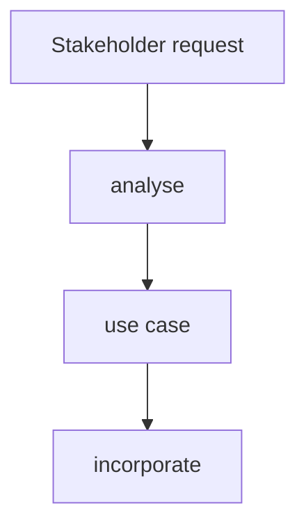

# Functionality

Functionality or functional requirements is
A set of desired features that strives to solve a problem requested by [[Stakeholders]].

### Action of functional requirement collection and change

it is important to do sufficient [[System analysis (Main)]] before implementation to determine the feasibility of the [[system]]. 
