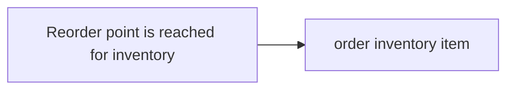

# Event

Event is something that occurs at a specific time and place, can be described.

| Type           | Description                                                                                                    |
| -------------- | -------------------------------------------------------------------------------------------------------------- |
| External Event | an event that occurs outside of the system, usually initiated by an external actor                             |
| Temporal Event | an event that occurs as a result of reaching a point of time                                                   |
| State Event    | an event that occurs when something happens inside the system                        ( will trigger response ) |

![[Event example.png]]

State event example isn't included so I'll put here:

#### Overview
Used in [[Event decomposition technique]].