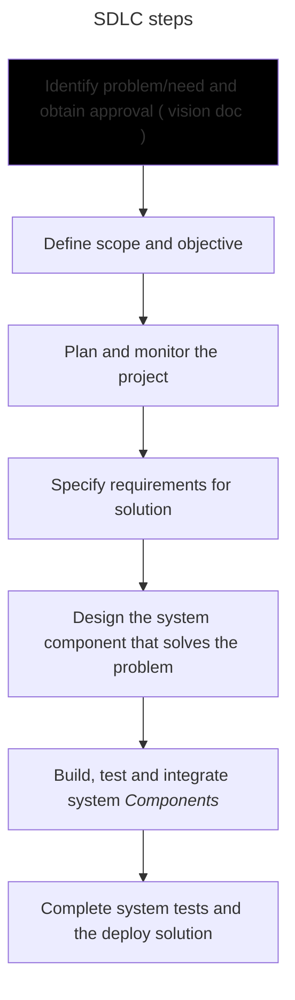

<h3>Gather detailed information</h3>
<h4>How?</h4>
- Interview 
- questionnaires
- reading documents and reports
- observing business processes
- researching vendors
- comments and suggestions

<h4>Project Approval factors</h4>
- Estimated time of completion
- Estimated cost of development
- Estimated cost for support 
- [[Cost benefit analysis]]

<h4>Steps to review clients and obtain approval</h4>
1. Executive committee review and approve
2. Board must review and approve for very large projects] 
3. Involved [[stakeholders]] need to understand what is expected of them] 
4. IS department needs to know what to do for staffing and support] 
5. Whole organization should be made aware of the project and its importance
