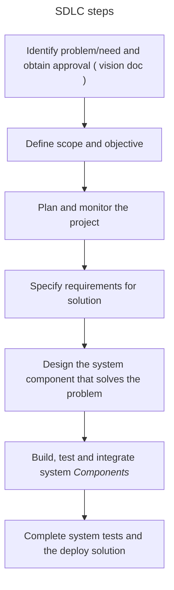

 SDLC ( system development life cycle ) is a systematic process that helps developers **plan, create, test, deploy, and maintain** software.

[[Obtaining Approval]]

[[Project management|Plan and monitor]]
[[Specify requirements]]

SDLC is a guideline as to what to do in a project, [[Project management strategies]] use SDLC but also implements their own philosophy. 