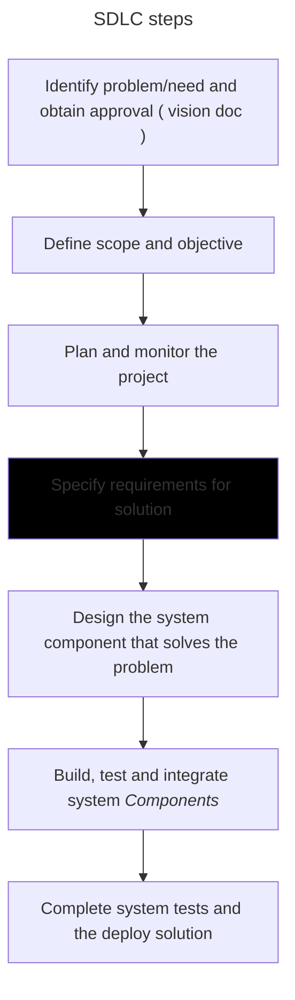

<h2>Requirements</h2>
Defined by [[FURPs]]

Requirements are separated into two categories:
**Functional**
- F ([[Functionality]])
- Fundamental components that are required for operation
- Examples:
	- Wheels on a car
	- Legs on a table

**Non-functional**
- URPs ([[Usability]], reliability, performance, security)
- Additional features that are ***important*** for other aspects besides function
- Example:
	- Locks on car door
	- Rounded edges on a table

