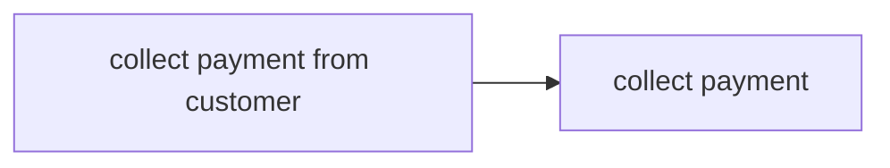
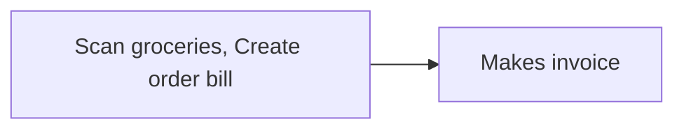
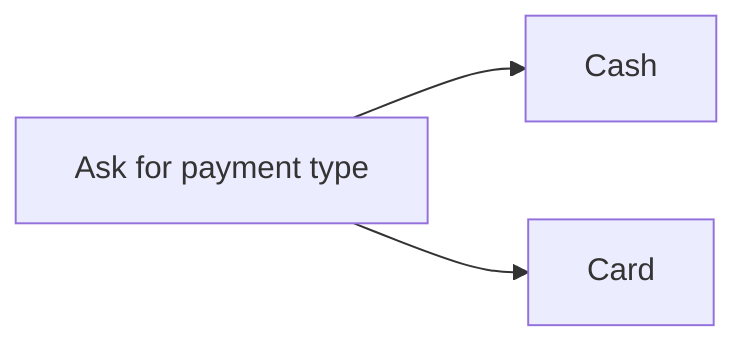

# User goal technique

User goal technique create use cases by asking the actors what their goals with the system and using the goals to create a general use case.

#### Application
lets assume the system is a ***supermarket***

I interview the **cashier**.
I ask the cashier what they use the supermarket system for.

They reply:
1. Scan groceries 
2. Create order bill
3. Ask customer for payment type
4. collect payment from customer

These are the goals of the **cashier** which can be converted into use cases.

***combine*** duplicate or closely related goals.

![[Cashier user goals.excalidraw|500]]
