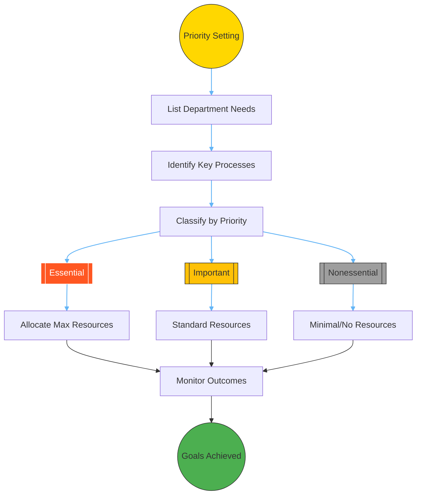

- A documented set of processes and procedures that are carried to recover the IT infrastructure in the event of a ***potential*** disaster ^727b68
- Disaster can be man-made or natural 
### Why make a recovery plan

|                                          |                                                                                                                   |
| ---------------------------------------- | ----------------------------------------------------------------------------------------------------------------- |
| sense of security                        | Allow for operations to continue in the face of a disaster                                                        |
| Reducing delay in recovery process       | Coordinated steps reduce chances of conflict and delay                                                            |
| Guaranteed reliability of standby system | Documented procedures ensure all bases are covered                                                                |
| Providing a standard test plan           |                                                                                                                   |
| Minimising the time taken                | decision making is offset to the plan                                                                             |
| Mitigating legal liabilities             | The recovery plan could hold the case that the company had sufficient [[Security control\|security measures]] and |
### planning process
#### Forming a disaster recovery team
- DR team (disaster recovery)
- consists of members from all departments and few representatives from top management
- Overseer of recovery process
#### Performing risk evaluation
- DR team identify the risks that could **affect organisational operation** closely related to the **IT infrastructure**
- The impacts and consequences should be noted 
- recovery plan should be made in consideration of **the worst case scenario**
#### Prioritizing processes and operations
- Identify **critical systems** that should be prioritised
- Examples:
	- functional operations 
	- information flow channels
	- sensitive data and existing policies
- Determine the **maximum time** that each department can operate w/o these critical systems
##### Prioritization process

#### Determine recovery strategies 
- Once again, the recovery strategies has to **cover all aspects of the organisation**
- aspects:
	- hardware and software
	- databases
	- communication channels
	- customer service 
	- end user systems ( websites, API etc. )
#### Data collection
- data that is related to the strategies should be **collected and documented**
- information such as:
	- contact details
	- other policies and procedures
	- [[SBOM]] and [[Asset inventory]]
	- backup schedules and storage sites + retention duration **
#### Testing period
- carry out the plan to check if the plan is **practical and effective**
- Tests done:
	- [[full-Interruption test]] **
	- [[parallel test ]]
	- [[simulated failures|simulations]]
	- [[checklist test]]
#### Obtaining approval
- DR plan submitted for upper management approval
- Grounds for acceptance:
	- Assurance that plan aligns with current organisation policies, procedures and contingency plans
	- DR plan is subjected to annual review 
#### Maintenance
- continuous monitoring and updates to respond to current [[Threat Landscape]]
- create an **updating schedule**
