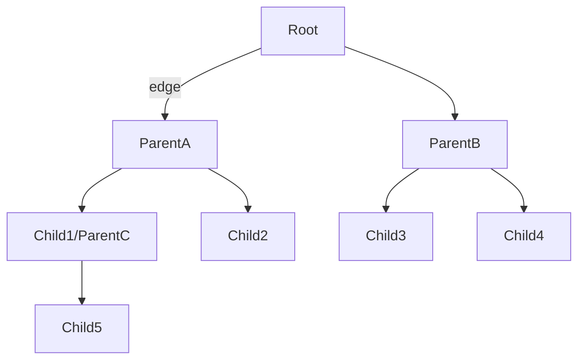

# Binary Search Tree

A [[Non-Linear]] data structure whose entires follow a [[hierarchical organisation]].

Anatomy of a BST:
- Edges (connects nodes)
- Nodes 
	- Leaf node (A node without any children)
	- Sibling nodes (two nodes from the same parent node) 
		- example: Child 3, Child 4


^c80ca3


<br><br> 
- Subtree (BST derived from a left or right child of a node)
	Left subtree
	```mermaid
		graph TD;
			
			ParentA --> Child1/ParentC;
			ParentA --> Child2;
			Child1/ParentC --> Child5;	
	```

	Right subtree
	```mermaid
		graph TD;
			ParentB --> Child3;
			ParentB --> Child4;
	```


Description of a BST:
- Size: refers to the total number of nodes
	- Example: This tree has 9 nodes ![[Binary Search Tree#^c80ca3]]
- Level: number of edges from the root
- Depth: refer to number of **edges** traversed from the root to reach **a node**
- Height: refer to the depth of the deepest node


<br><br>
Type of BST:
- Full tree: Every node has two child except the leaves.
- Complete tree: A full tree that is filled at every level except possibly the last, nodes are as far left as possible.
	- left and right subtree are equal in height (disregarding last level)
	- at the last level nodes are added from left to right