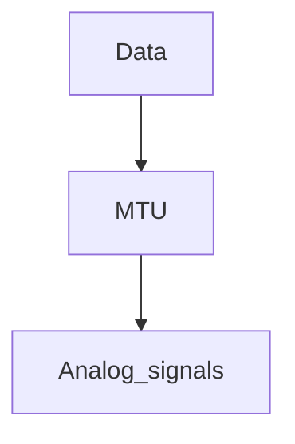

router:
to assign incoming packets to their corresponding mac addresses according to the ip header.

WAP ( wireless access point ):
allow for data transfer from wired to wireless devices.
has similar propeties to a **switch**

Switch:
redirects data to their corresponding ports via the mac address assigned 

Hub:
a switch but it just splits the signal across all ports

Bridge:
connect two seperate collision sites into a LAN.

scale of data:

### MTU
![[MTU]]

each part of an MTU is built on at each layer of the iso model

### Process

<fieldset>
<legend>legend</legend>
() = datagram/ current stage of data trasmutation
 *italic* is receiving 
 standard is sending
 layer 7-5 ( upper level data ):
HTTP, TCP and UDP are Set / *implemended*
</fieldset>

layer 7-5 ( upper level data ):
HTTP, TCP and UDP are Set / *implemended*

The data is...
compressed, encrypted and encoded  
*(decompressed, decrypted and translated/decoded)*

session established          **--------- Session ---------**

layer 4 ( segment ):
Data is dissesembled / *reassembled* into segments
assigned sequence number and checksum

![[Capture.png]]

layer 3 (packet):
segment is assigned a packet

a packet contains...
**1.** Source IP Address
**2.** Destination IP Address
**3.** TTL(time to leave)
**4.** Identification
**5.** Protocol type 
**6.** Version (version of protocol)
**7.** Options

layer 2 (frame):
the packet is assigned a frame
the frame contains the mac address (sender and recipient)

how its done(ARP): https://www.geeksforgeeks.org/how-address-resolution-protocol-arp-works/

layer 1 (bits/analog)
congrats its now 1s and 0s 
*welcome back*