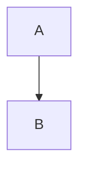

# Temp

Linked list 
-	has pointers ( takes up space )
-	has a sequence/ order

	- easier insertion and deletion
	- no predefined length

Array
-	uses index (takes up less space)
-	unstable
	- insertion and deletion requires high memory allocation
	- has predefined length (limited)

### database
for each table only 1 Primary key can exist
Foreign key has to be Primary key in a one-to-many/ many-to-one relationship

[[Foreign key]], [[Primary key]]

Backup : Primary form data loss prevention. Done periodically so that in the case of data loss it can be restored from the backup.

Archives: Long term storage for possible future use. The storage unit usually are cheaper and not stored on running disks as to reduce wear

Form control: inputs (Drop down list, tickbox...etc.)

when explaining traversal explain the entire mechanism 

base case: a condition for the function to terminate
base case doesnt necessarily make the function a recursion

Stack : first in last out 
	- used to delay the output until all the computation has been done

